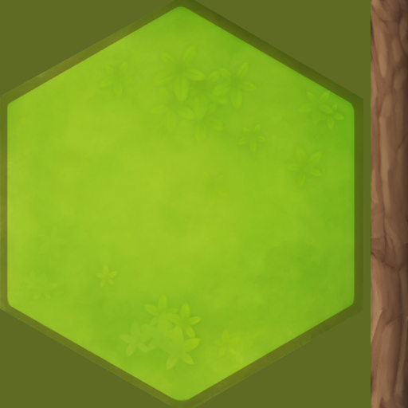

# Chisel

A Unity/C# hex-grid building and resource simulation prototype from November 2017.

*Original prototype tile artwork, not a gameplay screenshot.*

## What is here

- Procedural hex terrain classified with Simplex noise.
- Exploration, construction, production, and transport tasks with task scheduling.
- Connections between resource-producing and receiving buildings.
- Local game-state save/load and desktop/mobile input handling.

The main implementation is in [Chisel.Client](Chisel.Client/Assets/Scripts).
The server and shared projects are early scaffolding. This repository preserves
an older experiment; it is not a maintained release or a modern Unity template.

## Explore the project

The recorded editor version is **Unity 2017.1.1p3**. Open `Chisel.Client` as the
Unity project, then load `Assets/Scenes/MainScene.unity`. Use a disposable copy
before trying a newer editor because Unity upgrades may rewrite assets.

A fresh build has not been verified with a current toolchain. No automated test
suite or CI workflow is included.
